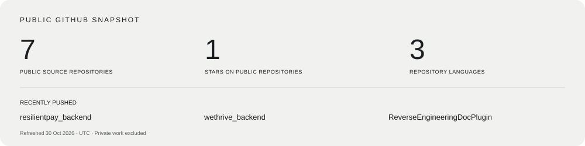

  <a href="https://danieljrnkulu.shapeit.solutions"><strong>Explore my portfolio ↗</strong></a> &nbsp; · &nbsp;
  <a href="https://shapeit.solutions">Shape It Solutions</a> &nbsp; · &nbsp;
  <a href="mailto:danieljrnkulu@shapeit.solutions">Let’s talk</a>

### I build software that holds together.

I’m Daniel, a Java software engineer with experience across banking, legal technology and business applications. I work on the boundaries where systems meet: APIs, asynchronous workflows, reliable processing and the operational details that make a product supportable.

At **Shape It Solutions**, I bring that thinking to practical digital products and business software. My portfolio applications are independently built demonstrations; employer experience is described separately on my website.

### Selected work

| Project | What to explore | Live / source |
| :--- | :--- | :--- |
| **ResilientPay** | Reversal orchestration, idempotency, safe retry, maker/checker reconciliation and redacted audit evidence. Synthetic payments only. | [Demo ↗](https://resilientpay.shapeit.solutions) · [Java source](https://github.com/danmjrn/resilientpay_backend) |
| **WeThrive** | Shared planning, goals and an offline-aware product experience. | [Application ↗](https://wethrive.shapeit.solutions) · [Java source](https://github.com/danmjrn/wethrive_backend) |
| **ShapeIT Invitations** | Invitation, RSVP and event administration workflows. Development continues. | [Protected staging ↗](https://shapeit-invitations.shapeit.solutions) |
| **Reverse Engineering Doc Plugin** | An IntelliJ proof of concept for Java project analysis and documentation prompts. | [Kotlin source](https://github.com/danmjrn/ReverseEngineeringDocPlugin) |

**Access:** ResilientPay uses a shared demo password; WeThrive requires an account invitation; ShapeIT Invitations is protected staging. Contact me for a guided demonstration. Credentials are never published here.

### Tools I work with

`Java` `Spring Boot` `REST / SOAP` `RabbitMQ` `PostgreSQL` `React / Next.js` `Docker` `GitHub Actions` `Testing & observability`

I care about explicit contracts, compatibility, bounded retries and clear evidence when a system cannot safely make a decision.

### Public activity

The card is generated from GitHub’s public repository metadata. It describes public work, not private contributions or a measure of engineering ability.

---

**Have something in mind?** [Visit my portfolio](https://danieljrnkulu.shapeit.solutions) or [start a conversation](mailto:danieljrnkulu@shapeit.solutions).
