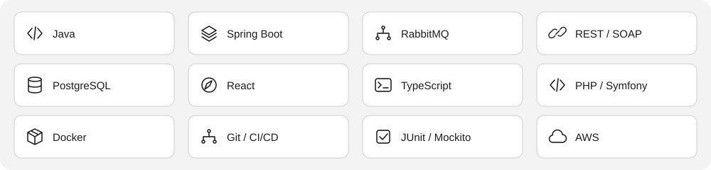

<strong>BSc Computer Scientist | Java Software Engineer | Independent Contractor</strong>

  
  
  
  

##  About me

I’m a Java software engineer and independent contractor with a BSc in Computer Science and experience across banking, legal technology, equipment and engineering operations, marketplaces, logistics and mobile applications.

At FNB, I modernise ATM Supervisor integrations while preserving device behaviour, Line-By-Line accounting, journals and receipts, and build reusable asynchronous reversal processing with Java, Spring and RabbitMQ. Through Shape It Solutions, I develop Java applications, REST APIs and operational tools for Proworx Mining and Engineering Africa.

My earlier work spans LexisNexis citation processing and database resilience; Convergenc3 system documentation and Salesforce customisation; Morphed’s PHP/Symfony marketplaces; LibertasGH trading and media applications; and part-time Java development for African Resources’ Zoul logistics platform. I focus on clear contracts, testing, operational diagnostics and maintainable software.

##  What I work on

- **FNB:** ATM Supervisor integration, Java modernisation and asynchronous reversal processing.
- **Independent Contractor through Shape It Solutions:** Java applications and operational tools for Proworx Mining and Engineering Africa.
- **Independent portfolio work:** practical applications that demonstrate the engineering approach behind the code.

##  Selected projects

| Project | What to explore | Live / source |
| :--- | :--- | :--- |
| **ResilientPay** | Reversal orchestration, idempotency, safe retry, maker/checker reconciliation and redacted audit evidence. Synthetic payments only. | [Demo ↗](https://resilientpay.shapeit.solutions) · [Java source](https://github.com/danmjrn/resilientpay_backend) |
| **WeThrive** | Shared planning, goals and an offline-aware product experience. | [Application ↗](https://wethrive.shapeit.solutions) · [Java source](https://github.com/danmjrn/wethrive_backend) |
| **ShapeIT Invitations** | Invitation, RSVP and event administration workflows. Development continues. | [Protected staging ↗](https://shapeit-invitations.shapeit.solutions) |
| **Reverse Engineering Doc Plugin** | An IntelliJ proof of concept for Java project analysis and documentation prompts. | [Kotlin source](https://github.com/danmjrn/ReverseEngineeringDocPlugin) |

**Access:** ResilientPay uses a shared demo password; WeThrive requires an account invitation; ShapeIT Invitations is protected staging. Contact me for a guided demonstration. Credentials are never published here.

These are independently built portfolio applications. The employer and client experience below is separate career experience.

##  Experience

Open a role to explore the same responsibilities described in my CV.

<strong>FNB | Developer III</strong> · 2025 - Present

 

2025 - Present | Johannesburg, South Africa

- Modernised Dynabob Supervisor integration paths from the legacy TransactionManager to RestTransactionManager, moving direct SOAP/HTTP calls behind typed REST APIs while retaining terminal-owned state machines, pageflows and hardware operations.
- Preserved Line-By-Line accounting, cash-load/removal journals, receipts and monetary precision; added interim/final response handling, request correlation and single-attempt safeguards to avoid automatic reposting of uncertain financial operations.
- Implemented SupervisorService in SSDPortal and contributed its extraction into a standalone Java 21/Spring Boot service for cash-ledger transfers, ICOM cash orders, retail support and location checks, retaining required downstream SOAP contracts.
- Added focused unit, contract and transaction-lifecycle tests for success, rejection, timeout and response-mapping cases; maintained ATM/service integrations and supported ISO 8583-related transaction and reversal work.
- Designed and implemented a reusable Java/Spring reversal framework for cash withdrawals, deposits, balance enquiries and PIN changes, replacing synchronous caller-to-host reversal processing with queued acceptance and asynchronous execution.
- Built RabbitMQ command publishing and consumption with durable queues, persistent messages, publisher-confirm support, transaction correlation and manual acknowledgements, separating request acceptance from downstream processing and making failures easier to trace.
- Created typed operation handlers, queue-safe payload mapping and feature controls to reuse reversal logic across transaction services while retaining a selectable synchronous path; prepared the framework as a shared library for microservice migration.

<strong>Shape It Solutions (Pty) Ltd — Java Software Engineer | Independent Contractor</strong> · February 2026 - Present

 

Shape It Solutions (Pty) Ltd 
Client: Proworx Mining and Engineering Africa 
February 2026 - Present

- Develop and maintain Java applications supporting equipment, procurement and engineering-service operations.
- Implement functionality for equipment records, availability, rental requests and maintenance histories.
- Build tools for tracking customer enquiries, quotations, supplier information and purchase requests.
- Design REST APIs and data-validation processes to exchange operational information between business applications.
- Develop reports and dashboards showing equipment status, outstanding requests and project activity.
- Work with management to define requirements, document technical solutions, test changes and support application maintenance.

<strong>LexisNexis | Software Engineer II</strong> · 2023 - 2025

 

2023 - 2025 | South Africa

- Developed and enhanced JCite, the Java citation engine supporting LexisNexis+, with work on recognising citations in legal documents, particularly Reporter citations, and extending existing engine functionality.
- Implemented a buffering solution around the AllCite database dependency so citation-processing work could be retained and recovered during database disruption, reducing interruption to the service.
- Produced detailed system specifications and contributed to architecture reviews, considering scalability, dependency failures and the maintainability of changes to an established citation-processing service.
- Integrated and improved delivery pipelines using Jenkins and Azure DevOps, and used Splunk, CloudWatch and Coralogix to investigate application behaviour and strengthen operational feedback.

<strong>Convergenc3 | Junior Software Engineer</strong> · 2023

 

2023

- Contributed to application design, development, testing and troubleshooting across client projects, translating existing systems and requirements into practical implementation work.
- Documented the Bluespec Edge Parts system landscape and customised Salesforce functionality for LIV Village using Apex and Visualforce.

<strong>Morphed | PHP / Symfony Software Developer</strong> · 2022 - 2023

 

2022 - 2023

- Developed and maintained marketplace functionality using PHP/Symfony, including application design, implementation, testing and quality assurance.
- Improved search and usability for Partnership Leaders, delivered marketplace features for Unbounce, and maintained the Crossbeam Marketplace as its requirements evolved.

<strong>LibertasGH | Intern Software Engineer</strong> · 2021 - 2022

 

2021 - 2022

- Contributed to the Libex crypto-trading client application, including secure transaction functionality, building experience in a trading-related product environment.
- Worked across backend and frontend development for the Salam Media app, strengthening coding, debugging and testing skills through collaborative delivery.

<strong>African Resources | Software Engineer (Part-Time)</strong> · 2020 - 2025

 

2020 - 2025

- Developed and maintained Java components for Zoul, a mobile-enabled logistics platform supporting the transport of goods and people.
- Maintained and improved existing functionality, performance and efficiency during a part-time engagement alongside study and other roles.

##  Technical skills

| Area | Technologies and practices |
| :--- | :--- |
| **Java & integration** | Java, Java EE, Spring, Spring Boot, Maven, REST APIs, SOAP, JSON, XML |
| **Messaging & architecture** | RabbitMQ, asynchronous processing, event-driven systems, state machines, typed contracts, legacy modernisation, microservice decomposition |
| **Data** | SQL, PostgreSQL, MySQL, Microsoft SQL Server, MongoDB, request/response mapping and validation |
| **Testing & quality** | JUnit, Mockito, unit and integration testing, contract/lifecycle testing, TDD, code reviews |
| **Delivery & diagnostics** | Git, GitHub, Bitbucket, Jenkins, Azure DevOps, CI/CD, Docker, Splunk, CloudWatch, Coralogix |
| **Additional development** | Python, C++, PHP/Symfony, Apex, Visualforce, TypeScript, JavaScript, React, React Native, HTML, CSS |
| **Platforms & collaboration** | AWS, DigitalOcean, Agile/Scrum, Jira, Azure DevOps, ClickUp, MS Project |

##  Education

**BSc in Computer Science** 
Eduvos, formerly Pearson Institute of Higher Education 
2019 - 2021

**National Senior Certificate (Matric)** 
Jeppe High School for Boys 
Awarded 2015 · Attendance: 2011 - 2015

##  Languages and interests

**Languages:** English · French · Swahili (Katanga Dialect)

**Interests:** Coding, literature, music, soccer, basketball, cinema, photography

##  Public activity

The card is generated from GitHub’s public repository metadata. It describes public work, not private contributions or a measure of engineering ability.

##  Connect with me

[Portfolio ↗](https://danieljrnkulu.shapeit.solutions) · [LinkedIn ↗](https://www.linkedin.com/in/daniel-jr-nkulu-a18003189/) · [Email](mailto:danmjrn@gmail.com) · [Shape It Solutions ↗](https://shapeit.solutions)

Johannesburg, South Africa
